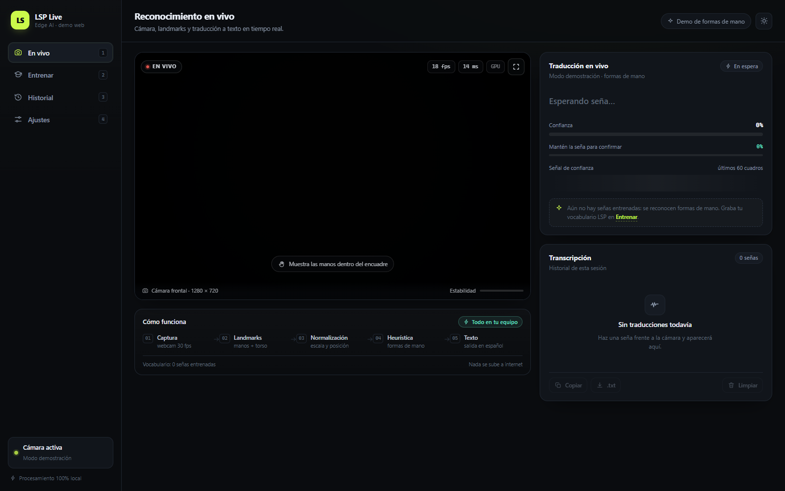
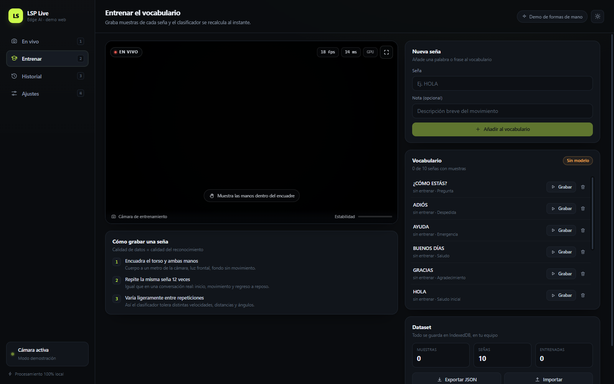
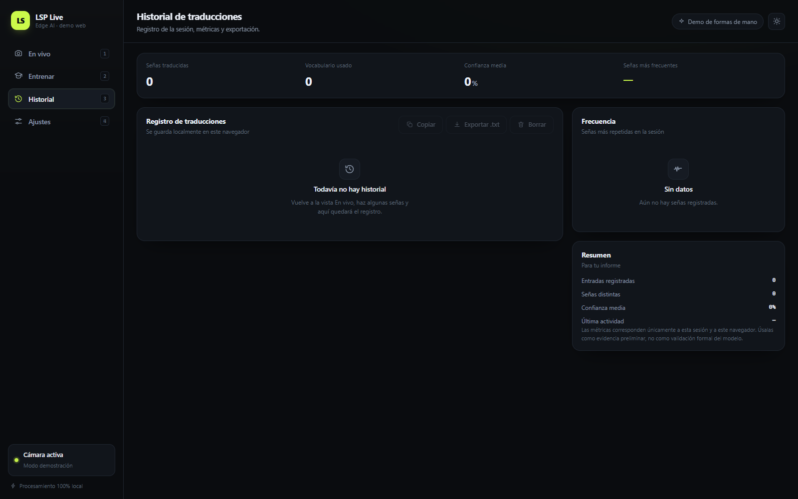
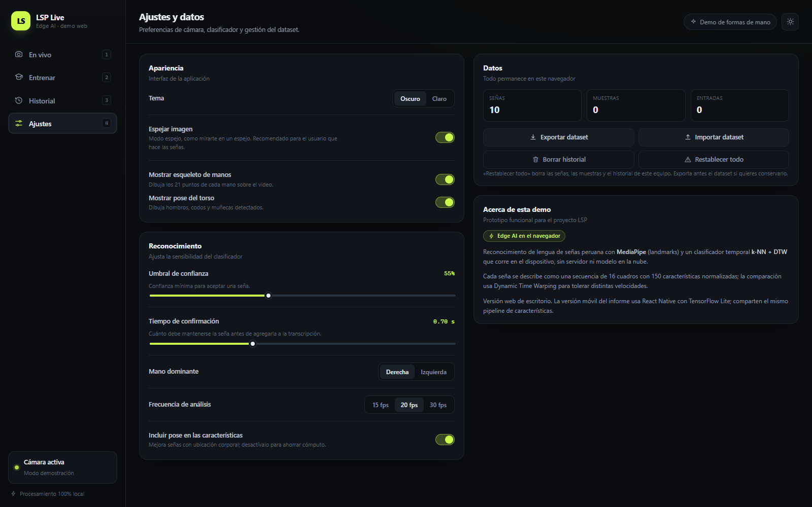

# LSP Live

**Reconocimiento de lengua de señas peruana (LSP) en tiempo real, directamente en el navegador.**
MediaPipe extrae los puntos de las manos y del torso; un clasificador temporal (k-NN + DTW) traduce
las señas a texto en español. Sin servidor, sin nube, sin enviar un solo frame a internet.




---

## Qué es

Una aplicación web de escritorio que convierte la webcam en un intérprete de señas:

- Detecta **dos manos** (21 puntos cada una) y la **pose del torso** en tiempo real.
- Normaliza las coordenadas para que la distancia a la cámara y la posición del cuerpo no afecten
  al reconocimiento.
- Compara la secuencia de movimiento con las muestras que tú hayas grabado y devuelve la palabra
  con su nivel de confianza.
- Guarda vocabulario, muestras e historial **en el propio equipo**.

Es la versión web del proyecto *Aplicación móvil de reconocimiento de lenguaje de señas en tiempo
real mediante Edge AI* (Laboratorio de Apps Autónomas y Edge AI, 8.º ciclo). Sirve para validar el
pipeline completo y llevar una demo funcional sin depender de un teléfono.

## Características

| | |
|---|---|
| 🎥 **En vivo** | Video con esqueleto de manos y torso, palabra detectada, confianza, top-3 y barra de estabilidad |
| 🎓 **Entrenamiento** | Da de alta una seña y graba 12 muestras en ~10 s; el clasificador queda activo al instante |
| 🕘 **Historial** | Registro con hora, origen y confianza; exportación a `.txt` y PDF, copia al portapapeles |
| ⚙️ **Ajustes** | Umbral de confianza, tiempo de confirmación, mano dominante, fps, pose, espejo y tema claro/oscuro |
| 💾 **Dataset portable** | Exportación e importación en JSON de todas las señas y muestras |
| 🙌 **Modo demo** | Sin entrenar nada reconoce 5 formas de mano con reglas geométricas |
| 🔌 **Offline** | Modelos y runtime WASM servidos localmente; funciona sin conexión |

### Capturas

| Entrenar | Historial |
|---|---|
|  |  |

| Ajustes | Modo claro |
|---|---|
|  | Cambia el tema desde la barra superior |

## Arranque rápido

Requisitos: **Node.js 18+**, **Chrome o Edge** actualizado y **webcam**.

```bash
npm install
npm start          # http://127.0.0.1:5180
```

En Windows también puedes hacer doble clic en **`iniciar.cmd`**.

> La página debe servirse por HTTP: abrir `index.html` con doble clic (`file://`) bloquea la cámara
> y la carga del runtime WASM.

Producción:

```bash
npm run build      # genera dist/
npm run preview    # sirve dist/ en http://127.0.0.1:5181
```

## Cómo se usa

1. **Entrenar** → escribe el nombre de una seña («GRACIAS») y pulsa *Añadir al vocabulario*.
2. Pulsa **Grabar** y repite la seña de forma natural 12 veces. La app captura ventanas de 1,6 s.
3. Vuelve a **En vivo**: la seña ya se reconoce y aparece en la transcripción.
4. Ajusta el **umbral** si aparecen falsos positivos o si no confirma tus señas.

Consejos: encuadra torso y manos, luz frontal, fondo quieto y varía ligeramente la velocidad entre
repeticiones. Más muestras y más personas grabando = mejor generalización.

Atajos: `1` En vivo · `2` Entrenar · `3` Historial · `4` Ajustes.

## Cómo funciona

```
webcam 30 fps
  └─ MediaPipe HandLandmarker (2 manos × 21 puntos)  +  PoseLandmarker (torso)
       └─ Normalización: muñeca al origen, escala de palma; torso por ancho de hombros
            └─ Vector de 150 dimensiones por cuadro
                 └─ Ventana deslizante de 30 cuadros → remuestreo a 16
                      └─ k-NN con DTW contra las muestras grabadas
                           └─ Estabilización temporal → palabra confirmada
```

- **150 características:** mano principal (63) + segunda mano relativa (63) + 8 puntos del torso (24).
- **DTW (Dynamic Time Warping):** compara secuencias tolerando distintas velocidades y pausas.
- **Confianza:** softmax sobre las distancias por etiqueta, multiplicado por la calidad absoluta del
  mejor match (así una sola seña entrenada no devuelve 100 % ante un gesto desconocido).
- **Estabilización:** una seña se confirma solo si se mantiene `holdMs` y supera el umbral; después
  se bloquea hasta que cambie la seña o se pierdan las manos, evitando repetir la misma palabra.

## Estructura del proyecto

```
.
├─ iniciar.cmd              lanzador para Windows
├─ index.html
├─ vite.config.js
├─ public/
│  ├─ models/               hand_landmarker.task · pose_landmarker_lite.task
│  └─ wasm/                 runtime de MediaPipe Tasks
├─ src/
│  ├─ App.jsx               estado global, arranque de cámara, grabación y exportaciones
│  ├─ styles.css            sistema visual (tema oscuro/claro + estilos de impresión)
│  ├─ components/
│  │  ├─ CameraStage.jsx    video + canvas de landmarks + estados
│  │  ├─ LiveView.jsx       traducción, transcripción y pipeline
│  │  ├─ TrainView.jsx      alta de señas, grabación y dataset
│  │  ├─ HistoryView.jsx    registro, métricas y exportación
│  │  ├─ SettingsView.jsx   preferencias y datos
│  │  └─ Icons.jsx · ui.jsx componentes base
│  └─ lib/
│     ├─ vision.js          motor: cámara, inferencia, estabilidad y dibujo
│     ├─ features.js        normalización y heurística de formas de mano
│     ├─ classifier.js      remuestreo, DTW y k-NN
│     ├─ store.js           IndexedDB (señas y muestras)
│     └─ storage.js         preferencias, transcripción y utilidades
├─ docs/                    capturas para este README
└─ tests/
   ├─ core.test.mjs         pruebas de geometría y clasificador
   ├─ smoke.mjs             prueba E2E vía CDP
   └─ shots.mjs             captura de las vistas
```

## Pruebas

```bash
node tests/core.test.mjs
```

Cubre la detección de formas de mano, la normalización de landmarks, el remuestreo, el DTW y el
clasificador (incluido el rechazo de gestos desconocidos con una sola etiqueta entrenada).

Las pruebas E2E (`tests/smoke.mjs`) requieren la app corriendo y un Chrome/Edge con
`--remote-debugging-port` y cámara simulada.

## Relación con el informe del curso

| Informe (móvil) | Esta demo (web) |
|---|---|
| React Native / Flutter | React 18 + Vite (escritorio) |
| MediaPipe Holistic, 543 puntos | MediaPipe Hands + Pose, 150 características |
| LSTM en TensorFlow Lite int8 | k-NN + DTW en el navegador |
| SQLite / Realm | IndexedDB |
| Cámara nativa | `getUserMedia` + Canvas |
| Android 8+ / iOS 12+ | Chrome / Edge con WebGL 2 |

Esta demo **no sustituye** el entregable móvil: valida el pipeline de captura, normalización,
vocabulario y experiencia de uso en minutos.

## Roadmap

- [ ] Grabar el vocabulario real de **50 señas** con personas sordas o intérpretes.
- [ ] Entrenar el **LSTM** y exportarlo a **TensorFlow Lite int8**.
- [ ] Versión móvil en React Native (`react-native-vision-camera` + `react-native-fast-tflite`).
- [ ] Modo evaluación: accuracy/F1 por seña, matriz de confusión y latencia.
- [ ] Grabación de la sesión en video y exportación de transcripciones a PDF con membrete.

## Privacidad

Ni el video ni las muestras salen del equipo. No hay backend, analítica ni CDN: los modelos y el
runtime WASM se sirven desde la misma carpeta. Las señas (IndexedDB) y el historial
(localStorage) permanecen hasta que uses *Restablecer todo*.

## Créditos

- **Juan Marlon Ayala Veintemilla** — datos, pipeline, versión web y pruebas.
- **Sebastián Quispe Cutipa** — versión móvil en Flutter, almacenamiento offline.
- Asesoría: **Pedro de Lima Salomón Benites Toledo**.

Proyecto académico — Escuela Profesional de Ingeniería de Software, Facultad de Ingeniería y
Arquitectura. Lima, Perú · 2026.

## Licencia

[MIT](LICENSE)
